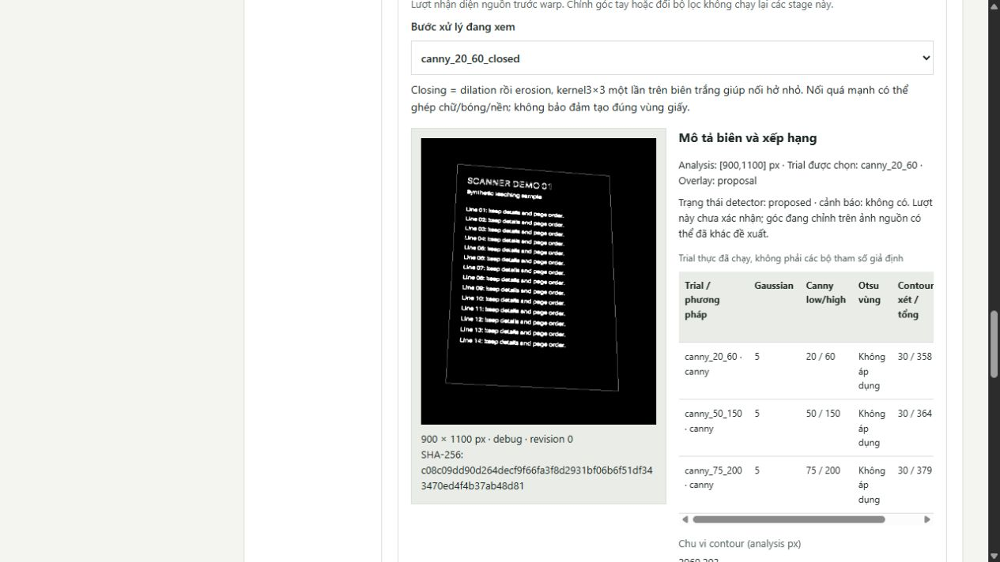
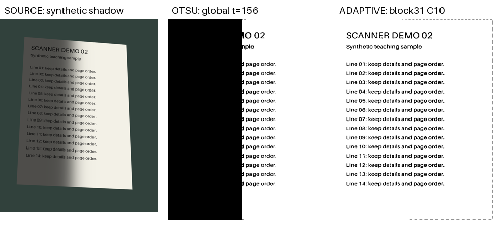
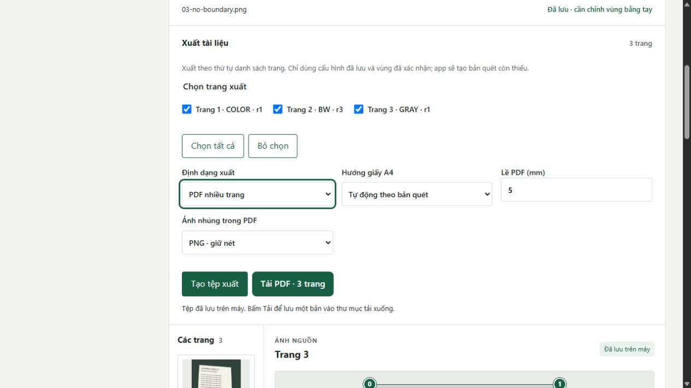

# Demo Document Scanner trong 5–7 phút

Kịch bản cho bản chạy cục bộ; thực hiện sau [README](../README.md). Mục tiêu là trình bày được
luồng dùng, ảnh trung gian thật và lý do chọn thuật toán. Các mốc dưới đây là thời lượng dự kiến,
không phải số đo hiệu năng. Bảng rehearsal thực tế được ghi riêng ở cuối.

## Chuẩn bị trước khi bắt đầu bấm giờ

Chạy app tại8000 (hoặc cổng riêng nếu8000 đang dùng). Dùng một tài liệu demo mới, không thao tác
trên tài liệu cá nhân. Mở [báo cáo](report.md), [câu hỏi bảo vệ](defense-questions.md) ở tab khác.
Đặt sẵn ba tệp `01-clean.png`, `02-shadow.png`, `03-no-boundary.png` trong [fixtures/demo](../fixtures/demo/README.md).
Cho lượt rehearsal có bấm giờ, nhập ba ảnh trước khi bắt đầu. Khi demo trực tiếp có thể nhập ngay
ở phần mở đầu nếu thao tác chọn file nhanh; đây không phải điều kiện để tính thời gian thuật toán.
Giữ `04-highlight.png` và `05-fold-light-simulation.png` để trả lời thêm, không đưa vào PDF chính.
Năm mẫu là tổng hợp. Mẫu nếp gấp chỉ mô phỏng ánh sáng; không phải một trang cong 3D.

Với máy cá nhân đã có ảnh development, có thể mở img_004 để chỉ ca ăn bàn, img_001/img_006 để chỉ
nếp gấp thật. Không dùng chúng làm số đo mới hoặc đem vào gói nộp. Nếu chưa có quyền chia sẻ
ảnh chụp, chỉ trình bày đồ thị hình học và số liệu trong báo cáo.

Tự thử trước máy chiếu: nhãn góc0–3 đọc rõ, scroll và zoom100% hoạt động, nguồn không bị che.
Nếu mạng không có ở lớp, hoàn thành cài/build trước; runtime localhost không cần gọi dịch vụ ngoài.
Đóng các tab khác đang sửa cùng tài liệu để tránh conflict. Không khởi động nhiều backend chung DB.

## Kịch bản chính, khoảng 6 phút

| Mốc | Thao tác và điều quan sát | Ý cần trình bày |
|---|---|---|
| 0:00–0:35 | Nêu bài toán; giới thiệu ba ảnh01/02/03 trong tài liệu demo đã nhập (hoặc nhập trực tiếp nếu đã thử trước). | Đầu vào JPEG/PNG, đầu ra trang chữ nhật/Color-Gray-BW/PDF; không OCR hay dewarp giấy nhàu. |
| 0:35–1:20 | Đợi nhận diện tự động cả ba; xem trang1, kiểm mép, **Xác nhận vùng**, Color → **Tạo bản quét**. | EXIF áp hướng metadata; analysis nhỏ để tìm góc nhưng warp lấy nguồn đầy đủ. Score không phải xác suất đúng. |
| 1:20–2:15 | Mở **Xem các bước xử lý và histogram → Nhận diện vùng**; xem raw Canny, closing, contour/overlay. | Gaussian giảm nhiễu; Canny tìm biên; closing nối hở nhỏ; contour/Douglas–Peucker biểu diễn; đặc trưng và score chọn quad. |
| 2:15–3:40 | Trang2: xác nhận; BW, Median3, không CLAHE, Otsu → tạo. Xem histogram/ngưỡng. Đổi Adaptive Gaussian31/C10 → tạo lại và so. | Cùng nguồn/góc/lọc, chỉ đổi threshold; Otsu một ngưỡng có thể đen bóng; Adaptive theo lân cận vẫn có thể mất nét. Không so hai ảnh khác warp. |
| 3:40–4:25 | Trang3 không có proposal. **Dùng toàn ảnh**, dịch một handle bằng mũi tên nếu muốn, **Xác nhận vùng**, Gray → tạo. | Ảnh cố ý đồng nhất, không có trang thật để phát hiện. Khung mặc định/toàn ảnh là lựa chọn tay, không phải detector thành công. |
| 4:25–5:20 | Chọn đúng3trang, PDF/A4/tự động/lề5/PNG → **Tạo tệp xuất**; mở link tải và kiểm3trang đúng01/02/03. | Xuất từ full render đúngrevision/thứ tự, không từ thumbnail. Mỗi trang cần xác nhận; trang thiếu render có thể được tạo khi xuất. |
| 5:20–6:00 | Reload, mở lại trang2/debug; chỉ đồ thị img_004 và bảng dataset trong báo cáo. | SQLite giữ nguồn/config/run; góc sai thì warp/filter không sửa được. Dataset13ảnh/2doc, mỗi split1doc;7/7test không phải100% tổng quát. |

Nếu cần rút xuống5phút, chỉ mở một trial Canny và một stage render; giữ phần fallback, so ngưỡng,
PDF và giới hạn. Nếu còn thời gian đến7phút, mở câu hỏi về mô tả biên hoặc Color/highlight.
Không bỏ kiểm vùng chỉ để kịp giờ. Không chạy benchmark hoặc sửa preset trong buổi demo.

## Phần thêm khi giảng viên hỏi

- **Highlight:** nhập04 vào một tài liệu phụ, Color rồi Gray/BW. Dải vàng tồn tại trong Color;
  mất màu trong BW là hệ quả nhị phân, không có nghĩa thuật toán khôi phục được chữ bị lóa.
- **Nếp gấp:**05 chỉ là vệt sáng tối, vẫn là đa giác phẳng. Mở ca development gấp thật nếu được phép;
  chỉ ra một homography không làm phẳng mặt giấy không đồng phẳng. Đề xuất chụp lại/trải giấy.
- **Ca sai:** đồ thị `boundary-description.png` cho thấy img_004 đề xuất ăn bàn, IoU≈0,8725.
  Không che ca này; chọn tay là fallback chính thức. Thêm gate fit/cạnh yếu chưa đủ chữa mơ hồ giấy–nền.
- **CLAHE:** bật ở Gray/BW, clip2/lưới8×8 là8tile mỗi trục, không phải ô8pixel. Xem histogram thật
  trước threshold; Color không áp CLAHE. Phải render lại rồi mới đọc run mới.

## Khi thao tác bị chặn

| Hiện tượng | Xử lý trong demo |
|---|---|
| Trang chưa xác nhận/nháp | Mở từng trang được chọn, kiểm góc và xác nhận; không sửa DB hoặc gọi API để né gate. |
| Nhận diện sai hoặc không có proposal | Chỉnh tay/Dùng toàn ảnh phù hợp, giải thích nguồn giới hạn; không tự gọi đó là nhận diện đúng. |
| Adaptive block quá lớn | Giảm block lẻ cho vừa warp hoặc chọn Otsu; app không tự clamp. |
| Busy/429 | Đợi hết tác vụ, không bấm tạo liên tiếp. Nếu conflict, tải lại và kiểm rồi thử chủ động. |
| Thiếu ảnh debug của run cũ | Bật xem stage và tạo lại một lượt; không thay bằng ảnh minh họa hoặc debug của trang khác. |
| Server chưa mở/build thiếu | Kiểm terminal/health/build theoREADME. Giữ DB, không xóa data để “sửa nhanh”. |

Nếu máy demo hỏng, ảnh chụp hướng dẫn và bảng số liệu là phương án trình bày dự phòng,
phải nói rõ đó là bằng chứng lượt chạy đã lưu, không giả đang chạy trực tiếp.

## Rehearsal và câu hỏi chưa rõ

Lượt kỹ thuật26/10 trên source/venv/DB giải nén sạch ở8002 mất **320,984s (5phút21giây)**,
tính từ sau khi nhập: Color, rawCanny/closing/descriptors, Otsu/Adaptive, chọn tay, PDF3trang,
reload/debug/giới hạn. Console0warning/error. Tạo PDF xong ở229,785s;65artifact vàmetadata
giữhash sau restart process298300→296284. PDF được render/xem đủ3trang và kiểm ảnh nhúng.
Ảnh3xám trống là mẫu khôngbiên cố ý, không phải lỗi mất trang; BW vẫn có ít biên/đốm của mẫu.

Công cụ tự động chọnfile mất434,907s để hoàn tất lời gọi; lượt nhập đã chạy qua UI và tựdetect2proposal/
1manual_required. Thời gian công cụ này được tách khỏi rehearsal sau nhập, không quy thành thời gianCPU
hoặc giấu trong benchmark. Rehearsal là thao tác/kiểm dữ liệu tự động, **chưa có phần nói thành tiếng**.

Kết quả chạy thử, thời gian, ảnh UI/PDF và những câu hỏi phải sửa được ghi tại
[audit giai đoạn14](audit-phase-14.md) và [checklist gói nộp](submission-checklist.md).
Thời gian điều khiển tự động không thay thế một lượt tập nói của người thuyết trình.
Trước buổi nộp, người trình bày nên tự tập nói một lượt theo các mốc trên và chuẩn bị thông tin nhóm/bìa
nếu giảng viên yêu cầu; hiện chưa được cung cấp tên nhóm, mã sinh viên hoặc mẫu báo cáo bắt buộc.
