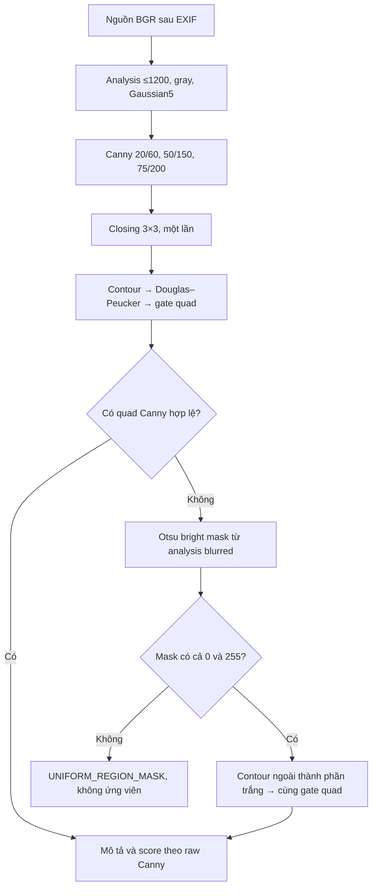

# Điều chỉnh phát hiện vùng trang — 15/10/2026

Người dùng chấp nhận thử cải thiện Canny và bổ sung nhánh vùng sáng sau hai ca thất bại img_004/anhtestnew. Tài liệu này ghi thay đổi đã triển khai trong AUX05.01, áp dụng lên hướng MVP05.01–04; hai đặc tả gốc tiếp tục là tham chiếu lịch sử. Không đổi kiến trúc, quota, geometry, warp, lọc ảnh sau warp hoặc công thức score.

## Quyết định và căn cứ

Thử Gaussian3/5 với năm cặp Canny50/150,75/200,100/250,20/60,10/30 và Otsu vùng sáng:16ca×12biến thể,192overlay tại experiments/results/detection-revision-ablation/ (ignored). Đây là khảo sát hữu hạn, không phải retry runtime để ép mọi ảnh thành quad. Bộ ảnh gồm6development cùngdoc_01,1ảnh bổ sung chưa có identity/split và9ca tổng hợp; không có GT/test độc lập.

- Giữ Gaussian5/sigma0/REFLECT_101. Gaussian3 không cho cải thiện đều; kernel3 chỉ là tùy chọn ablation có metadata rõ.
- Preset revised dùng đúng3cặp20/60,50/150,75/200. 20/60 khôi phục được mép anhtestnew. 10/30 sinh thêm quad ăn sang mặt bàn nên chưa chọn. 100/250 được giữ trong baseline; chưa chứng minh việc bỏ cặp này không ảnh hưởng mọi ảnh chưa thấy.
- Baseline giữ nguyên Gaussian5 và50/150,75/200,100/250, không nhánh vùng, để tái hiện phép chạy trước.
- Nếu cả3trial Canny không có quad hợp lệ, chạy thêm tối đa1mask Otsu vùng sáng. Khi đã có quad Canny, không chạy nhánh vùng để tranh điểm với ứng viên đó. Đây là điều kiện dự phòng theo tồn tại hình học, chưa phải đánh giá đúng/sai trang.

## Luồng hiện hành



Otsu chia theo độ sáng bằng một ngưỡng global t do histogram quyết định; nó có thể gộp cả giấy và bàn sáng, không có ngữ nghĩa nhận biết giấy. Dùng THRESH_BINARY|THRESH_OTSU trên analysis blurred, giữ t thực. RETR_EXTERNAL/CHAIN_APPROX_SIMPLE lấy đường bao ngoài của các thành phần trắng; bỏ biên lỗ bên trong mà không sửa/fill mask. Không cần gọi connectedComponents thêm chỉ để tìm lại cùng đường bao. Tham chiếu [OpenCV thresholding](https://docs.opencv.org/4.x/d7/d4d/tutorial_py_thresholding.html) và [shape API](https://docs.opencv.org/4.x/d3/dc0/group__imgproc__shape.html).

Mask toàn0 hoặc toàn255 không có phân tách vùng nên trả batch bị loại trước contour với UNIFORM_REGION_MASK; vẫn lưu mask thật, không xóa pixel để làm đẹp kết quả. Không tăng closing, hạ gate10% hoặc bịa cạnh thiếu. Gate chung vẫn top30/trial, epsilon/P=.015/.02/.03, area contour/Q≥10%WaHa, từng cạnh≥5%min(Wa,Ha), validate topology trước sorter, canonical start theo pixel nguồn thật.

## Hợp đồng lõi và bằng chứng ảnh

- `prepare_analysis(source, gaussian_kernel=5)` giữ default5, cho phép đúng số nguyên3/5; AnalysisImages ghi kernel. Không thay nguồn/mapping W−1/H−1.
- `create_edge_trials(blurred, preset='baseline', gaussian_kernel=5)` giữ mặc định cũ để tái hiện; preset revised là ba cặp mới. G5 giữ ID canny_low_high; G3 dùng canny_g3_low_high để không nhập nhằng stages.
- **Entry hiện hành:** `collect_candidates(analysis, preset='revised')` trả tuple TrialCandidates(trial,batch), tối đa3Canny+1RegionTrial. Chưa NMS, chọn proposal/fallback hoặc confirmed.
- RegionTrial tách mask khỏi raw edges, giữ otsu_threshold/support_trial_id/thresholds/kernel. `thresholds` là cặp Canny dùng đo hỗ trợ, không phải t của Otsu. Raw support được copy từ trial20/60 cùng blur/dimensions; không dùng mask/boundary mask/closing làm e.
- ContourCandidate giữ method, gaussian_kernel, otsu_threshold hoặc null, bên cạnh trial/source_size/analysis_size/contour/Q. Describe revalidate chúng với trial; dữ liệu không khớp bị từ chối.

Chu vi/cạnh vẫn tính bằng px analysis, góc rad, các tỷ lệ và công thức S giữ nguyên. n=max(2,ceil(L/2)+1) gồm hai đầu; raw Canny support Euclid≤2px; e=sum(m)/sum(n), b theo cùng mẫu cách mép≤2px. Ứng viên vùng có raw biên yếu vẫn nhận e thấp và score thấp; không tự nâng score để coi nhánh mới thành công. Otsu ở đây nhằm tách giấy/nền trước warp, khác Otsu tách chữ/nền giấy sau warp của MVP04.

## Kiểm chứng bằng code và runtime

TDD:14tests cấu hình/kernel/preset fail vì thiếu kwargs →78tests detection đạt;16tests region/collector fail vì thiếu helper →94tests đạt0.83s. CLI5tests fail vì thiếu script →5tests đạt5.08s. Toànbackend **670passed in20.17s** =635cũ+30revision+5CLI; khôngskip/nới checks. Test ảnh đồng màu, trang tương phản thấp/biên mất, holes, provenance/kernel, NaN/mask sai, lỗi CV, raw support0 dù mask hoàn hảo, EXIF/PNG/hash/no-overwrite. Số tests không phải accuracy.

CLI `experiments/compare_detection.py` chạy một ảnh, so baseline/revised và lưu stages/candidate/descriptor thật vào thư mục mới. Mỗi profile chỉ chọn ví dụ theo score để minh họa, còn lưu toàn bộ accepted/rejected attempts; candidate_count còn gồm các epsilon/trial trùng. Không tạo warp từ góc tự chọn hoặc xác nhận giả. Comparison thu từ overlay full, không thay tọa độ bằng preview.

```powershell
& .\backend\.venv\Scripts\python.exe experiments/compare_detection.py experiments/data/anhtestnew.jpg --output-dir experiments/results/my-detection-comparison
```

Thêm `--gaussian-kernel 3` để ablation revised; baseline vẫn5. Output phải là thư mục chưa tồn tại. Source PNG ghi đúng payload encode_normalized_png; metadata cuối, hashes/bytes/dimensions/mode/trial/method/actualt rõ. Cổng05/05-C2 và task05.05–08 chưa được nghiệm thu bởi CLI này.

Đã chạy16ca bằng entry mới,104trial/440PNG/272descriptors tại experiments/results/detection-revision-01-verified/ (ignored); xem đủ16comparison. Kết quả bên dưới là ví dụ có score cao nhất, chưa phải detector hoàn chỉnh hoặc nhãn đúng/sai đã đo GT:

| Ảnh | Accepted attempts baseline→revised | Quan sát/score revised |
|---|---:|---|
| anhtestnew |0→6|Canny20/60 bám sát giấy; S=.634709,e=.989837,a=.203138. Còn trùng3epsilon×2contour |
| img_001 |0→0|Góc giấy gấp và mép/nền phức tạp; chưa có quad |
| img_002 |12→12|Giữ ví dụ Canny cũ,S=.525122; chưa GT |
| img_003 |18→12|Giữ cùng quad/score .502372; giảm count do bỏ một trial trùng |
| img_004 |0→1|Region Otsu,S=.468352; **sai góc trái trên, ăn sang bàn** |
| img_005 |18→12|Giữ cùng quad/score .501182; chưa GT |
| img_006 |0→1|Region Otsu,S=.448517; **còn lấy cả bàn ở góc trái trên**, không phục hồi giấy gập |
| rectangle/diamond |18→18 mỗi ca|Giữ ví dụ .837687/.730757 |
| texture |18→18|Giữ quad và score .725465 |
| frame_and_paper |36→36|Vẫn chọn nhầm khung,S=.975859; thay sinh ứng viên chưa sửa lỗi scoring này |
| concave/self_cross/degenerate/open_edge/constant |0→0 mỗi ca|Không ép quad; constant được chặn UNIFORM_REGION_MASK |

Đếm ảnh có candidate ở6development tăng3→5, nhưng hai ca mới còn sai vùng; **không được gọi5/6 là accuracy**. Dataset vẫn6ảnh cùng1doc_01/test0; anhtestnew chưa vào manifest. Nhánh vùng là dự phòng có giới hạn, không bảo đảm tìm đúng trang trên nền sáng/bóng/giấy gập. Phần NMS/proposal/warnings/manual fallback ở05.05–06 và debug/timing ở05.07 phải tiếp tục giữ các giới hạn này.

QA cuối kiểm440PNG/hash/bytes/dimensions/channels/EXIF/binary,272descriptors và104trial khớp provenance/geometry/counts/score.64map raw/closed của hai cặp50/150–75/200 giữa baseline/revised trùnghash.6cặp nguồn development/normalized và22fixtures giữ nguyên; sourcePNG CLI trùngnormalizedhashCSV. Rà11tài liệu/90linknộibộ,34main+4AUX/110ID; ảnh/results/scripts.tmp đượcignore, khôngcommit/push hoặc gửiảnhra ngoài.
