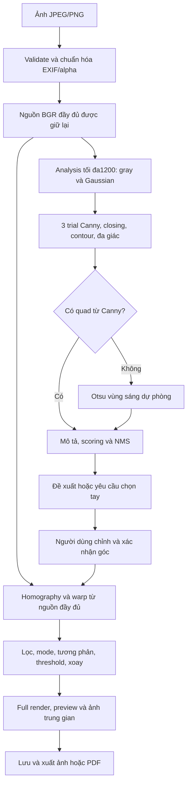
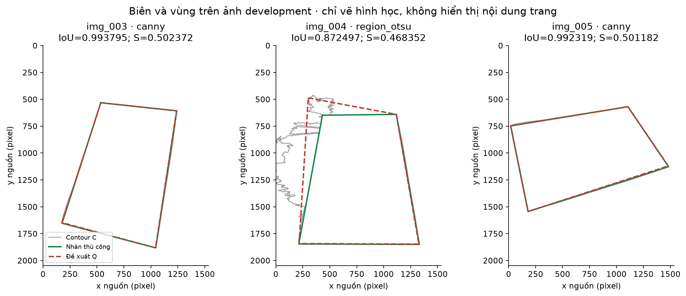
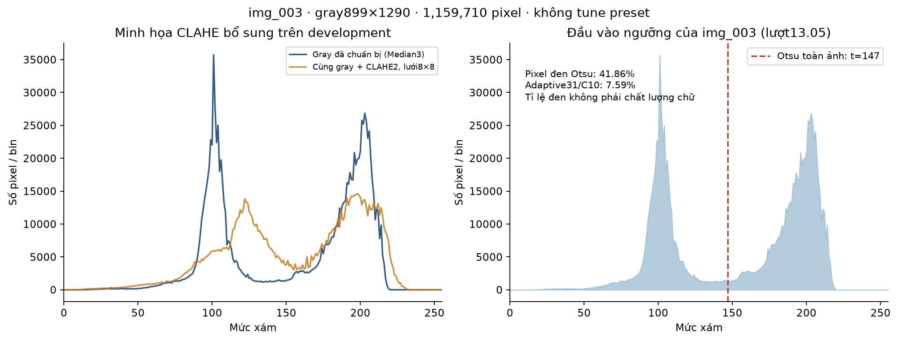
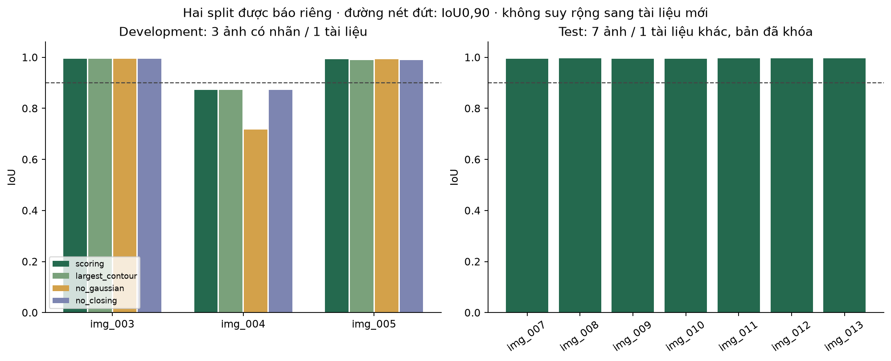
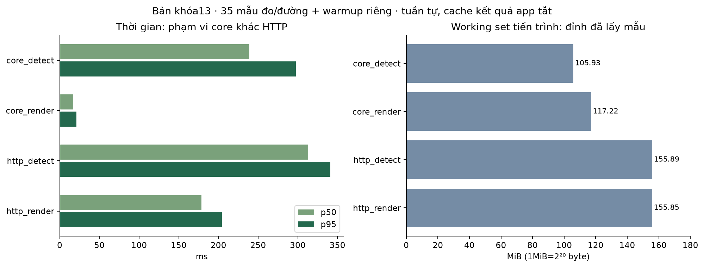

# Báo cáo Document Scanner MVP: thuật toán và thực nghiệm

Ngày 26/10/2026. Nội dung kỹ thuật của MVP14.05–06; demo/gói nộp14.07–08 đã kiểm ở
[audit14](audit-phase-14.md). Các ảnh thật/PDF môn học tham chiếu cục bộ không có trong gói nộp;
CSV/summary/hình báo cáo được giữ để đối chiếu số liệu.
Các số đo dưới đây lấy từ bản khóa thực nghiệm13, không phải đo lại trên bản đóng gói14.
Chỉ trình bày các chức năng đã có và giới hạn quan sát được.

## 1. Bài toán, đầu vào và đầu ra

Đầu vào là một hoặc nhiều ảnh JPEG/PNG chụp tài liệu trên nền thực tế. Ảnh có thể nghiêng,
có bóng, họa tiết nền hoặc nếp gấp nhẹ. Mục tiêu là đề xuất vùng trang, cho phép người dùng
chỉnh/xác nhận bốn góc, hiệu chỉnh phối cảnh và cải thiện ảnh để lưu/xuất.

Đầu ra trực tiếp của định vị trang là tứ giác hoặc yêu cầu chọn tay; đầu ra của warp là ảnh trang
hình chữ nhật. Sản phẩm còn có Color/Gray/BW, xoay, ảnh trung gian/histogram, quản lý nhiều trang,
lưu/mở lại và xuất PNG/JPG/PDF. PDF chứa ảnh, chưa có OCR. Ảnh nguồn được giữ nguyên.

Giả thiết hình học là trang gần phẳng và quan sát đủ bốn góc. Homography không phục hồi phần bị che,
chữ cháy sáng hoặc làm phẳng giấy nhàu/cong mạnh. Nếp gấp có thể tạo biên mạnh hơn mép giấy;
phát hiện một đường biên không đồng nghĩa đã nhận ra ngữ nghĩa “tờ giấy”.

## 2. Liên hệ với tài liệu môn học

Số trang dưới đây là **trang PDF, đếm từ1**. Cache text đã được kiểm lại SHA với ba PDF gốc;
chỉ các phần liên quan được dùng để đối chiếu, không tuyên bố đọc kỹ toàn bộ308 trang giáo trình.

| Nguồn | Nội dung dùng trong đồ án | Cách nối vào implementation |
|---|---|---|
| [Giáo trình](<Giáo trình _ Xử lý ảnh.pdf>), tr. 65–72 | Co, giãn, mở, đóng | Closing nhẹ trên bản đồ biên nhị phân |
| Giáo trình tr. 87–89,97–118; [slide5](<xla_Ch05 (1).pdf>), tr. 19–21,35 | Gián đoạn cường độ, gradient, làm trơn, ảnh hưởng ánh sáng không đều | Nhánh Gaussian/Canny; đối chiếu ngưỡng toàn cục và cục bộ |
| Giáo trình tr. 155–169,171–180; [slide6](xla_Ch06.pdf), tr. 17–19 | Biểu diễn, xấp xỉ và mô tả biên | Contour có thứ tự → đa giác → đặc trưng cạnh/góc/chu vi |
| [Phân tích hướng thuật toán](Phan_Tich_Huong_Thuat_Toan_Tu_Tai_Lieu.md), mục5.5.1–5.5.3 | Đơn vị, provenance, đặc trưng và nghiệm thu | Quy tắc triển khai đã kiểm trong code/debug |

Giáo trình trình bày **đa giác chu vi tối thiểu (MPP)**; `cv2.approxPolyDP` dùng
**Douglas–Peucker**, phù hợp ý tưởng chia đoạn ở slide 6 tr. 19, không được gọi là MPP.
`CHAIN_APPROX_SIMPLE` giữ điểm cần thiết của contour, không phải xuất mã chuỗi Freeman.
`findContours` cũng không được đồng nhất với một implementation Moore tự viết.
Canny, CLAHE và homography được nối bằng API OpenCV; không gán mọi chi tiết thư viện hoặc
công thức score của dự án thành kết luận đã có sẵn trong giáo trình.

## 3. Pipeline và các hệ tọa độ

Nguồn sau EXIF, ảnh analysis, ảnh warp và preview là các raster khác nhau.
Chỉ detection dùng analysis nhỏ; warp luôn lấy nguồn đầy đủ. Preview cạnh dài≤1000 được thu từ
full render sau xử lý/xoay, không làm đầu vào xuất hoặc phát hiện lại.

Với nguồn kích thước W×H, tọa độ chuẩn hóa là:

$$u=\frac{x}{W-1},\qquad v=\frac{y}{H-1}.$$

Đổi từ analysis về nguồn dùng cùng u,v rồi nhân Wnguồn−1,Hnguồn−1;
không chỉ chia một tỉ lệ resize lý tưởng vì dimensions có làm tròn. Giữ subpixel.
Trục ảnh x sang phải, y xuống; bốn góc theo chu kỳ. Sort góc chỉ áp cho đề xuất tự động,
không sắp lại các handle người dùng đang kéo. [Hợp đồng ảnh](image-contract.md).

## 4. Phát hiện và mô tả vùng trang

### 4.1. Chuẩn hóa và làm trơn

Kiểm JPEG/PNG tĩnh, tối đa15MiB/16triệu pixel, rồi giải mã/áp EXIF một lần,
ghép alpha lên trắng và chuyển thành BGR uint8. Metadata EXIF điều khiển hướng nguồn;
không có bước tự đọc chiều chữ. Nguồn và hash của PNG chuẩn hóa gắn với các góc đã lưu.

Detection thu nhỏ cạnh dài tới1200 bằng INTER_AREA, không upscale; chuyển xám
theo trọng số gần đúng0,114B+0,587G+0,299R rồi Gaussian 5×5, sigma0/BORDER_REFLECT_101.
Kernel Gaussian là trung bình có trọng số, được chuẩn hóa tổng bằng1;
làm trơn giảm nhiễu nhưng cũng làm mềm mép/nét nhỏ. sigma0 để OpenCV suy ra theo kernel.
Gaussian nhánh detection khác bộ lọc tùy chọn sau warp.

### 4.2. Canny và closing

Gradient dùng đạo hàm theo hai trục, với độ lớn L2 và hướng:

$$M=\sqrt{G_x^2+G_y^2},\qquad\theta=\operatorname{atan2}(G_y,G_x).$$

Gradient vuông góc tiếp tuyến biên. Canny dùng cực đại cục bộ theo hướng gradient để làm mảnh,
rồi hysteresis giữ biên mạnh và biên yếu liên thông phù hợp. App gọi Gaussian rõ trước Canny;
không giả định `cv2.Canny` tự thực hiện Gaussian của pipeline.
[Tài liệu Canny](https://docs.opencv.org/4.x/da/d22/tutorial_py_canny.html).

Preset hiện hành `revised`: ba cặp ngưỡng **20/60,50/150,75/200**,
aperture=3, L2gradient=true. Ngưỡng áp lên đáp ứng gradient, không phải xác suất hoặc mức xám giấy.
Baseline lịch sử50/150,75/200,100/250 được giữ để đối chứng; chưa có bằng chứng tối ưu phổ quát.

Với tập pixel biên trắng E và kernel vuông K=3×3:

$$E\bullet K=(E\oplus K)\ominus K.$$

Closing giãn rồi co, một lần, nhằm nối hở nhỏ trước lấy contour. Kernel quá lớn có thể nối chữ,
bóng và nền. Code dùng BORDER_CONSTANT với giá trị biên trung tính mặc định của OpenCV,
không tự coi nó là padding0. [Hình thái OpenCV](https://docs.opencv.org/4.x/d9/d61/tutorial_py_morphological_ops.html).
Ảnh raw và closed được giữ riêng; pixel mới từ closing không được dùng như bằng chứng Canny thô.

### 4.3. Contour, Douglas–Peucker và gate hình học

`findContours(RETR_LIST,CHAIN_APPROX_SIMPLE)` lấy đường bao từ closed, giữ tối đa30 contour
lớn nhất mỗi trial để xét. Với chu vi P, thử hữu hạn epsilon/P=0,015/0,02/0,03:
nối đoạn, tìm điểm xa đoạn nhất và chia tiếp khi vượt epsilon. Epsilon nhỏ giữ nhiều gợn;
lớn có thể mất góc hoặc ép vùng không phải giấy thành tứ giác.
[Contour/đa giác OpenCV](https://docs.opencv.org/4.x/dd/d49/tutorial_py_contour_features.html).

Chỉ nhận đa giác đúng 4 đỉnh, contour và quad đều có diện tích≥10%WaHa,
mỗi cạnh≥5%min(Wa,Ha), không tự giao/lõm/suy biến và có winding hợp lệ.
Không điều chỉnh epsilon vô hạn đến khi đủ4đỉnh; không ép góc90° vì phối cảnh làm góc ảnh bị xiên.
Geometry dùng khoảng cách/diện tích trong pixel với ngưỡng theo đường chéo,
không đo trực tiếp Euclid trên u,v khi hai trục có độ dài khác nhau.

Nếu cả ba trial Canny không tạo quad hợp lệ, thêm đúng một trial vùng sáng:
Otsu THRESH_BINARY trên ảnh analysis đã blur, RETR_EXTERNAL để lấy biên ngoài thành phần trắng.
Không fill lỗ hoặc thêm closing cho mask. Mask đồng nhất0/255 bị loại.
Mép vùng sáng có thể nối cả bàn vào giấy; đây là dự phòng heuristic, không phải phân loại giấy.

### 4.4. Mô tả biên khác với đặc trưng vùng

Contour C và quad Q là **biểu diễn**; chu vi/cạnh/góc là **mô tả biên**;
diện tích và vị trí trong ảnh bổ sung thông tin vùng/ngữ cảnh.
Mô tả giúp giải thích/xếp hạng, không chỉ phát hiện một tập pixel biên rồi cắt ngay.

| Đại lượng | Định nghĩa/đơn vị | Cách dùng |
|---|---|---|
| P(C),Li | Chu vi contour, bốn độ dài cạnh, pixel analysis | Giải thích/kích thước; cạnh tham gia gate |
| Góc đổi hướng | atan2(cross(e trước,e sau),dot(e trước,e sau)), radian | Mô tả cấu trúc; không có hạng góc vuông trong score |
| a | A(Q)/(WaHa) | Kích thước vùng so với ảnh |
| f | min(A(C),A(Q))/max(A(C),A(Q)) | Khớp **diện tích**, không phải sai số khoảng cách biên |
| e | Tổng mẫu được Canny hỗ trợ / tổng mẫu | Bằng chứng tại vị trí các cạnh Q |
| b | Tỉ lệ mẫu cạnh cách viền ảnh≤2pixel | Phạt khả năng chọn khung/nền sát mép |

Trên cạnh dài Li, lấy ni=max(2,ceil(Li/2)+1) mẫu gồm cả hai đầu, khoảng cách≤2pixel analysis.
Mẫu có tâm pixel trắng raw Canny cùng trial cách Euclid≤2pixel được hỗ trợ; mi là số mẫu đó:

$$e_i=\frac{m_i}{n_i},\qquad e=\frac{\sum_i m_i}{\sum_i n_i}.$$

Không lấy trung bình không trọng số của bốn ei. Region trial dùng raw Canny20/60 của cùng analysis
để đo e, không dùng mask Otsu hoặc closed. Giữ provenance, counts và tỉ lệ từng cạnh trong debug.

Score do dự án thiết kế, không phải công thức trong giáo trình:

$$S=\operatorname{clip}(0{,}45a+0{,}35e+0{,}20f-0{,}15b,0,1).$$

Chu vi/góc/lồi không có trọng số bổ sung trong S. Khớp diện tích cao không bảo đảm contour và quad
gần nhau tại mọi điểm; e tổng cũng có thể che một cạnh yếu. Score không được hiệu chuẩn thành xác suất.

Hình1 lấy tọa độ thật của C/Q/nhãn từ metadata13.03–04, ánh xạ contour analysis về pixel nguồn.
Không hiển thị nội dung trang. Trường hợp img_004 cho thấy vùng sai vẫn có thể là một quad hợp lệ.
Trên img_003/trial50/150, raw có9.644 pixel trắng và closed12.287 pixel;
phần tăng2.643 pixel chỉ mô tả tác dụng closing, không đo “đúng biên giấy”.

### 4.5. NMS, trạng thái và xác nhận

NMS tham lam duyệt S giảm dần, giữ thứ tự đầu vào khi bằng điểm; loại quad có IoU **>0,95**
với survivor. Không dùng ≥ và không trộn bằng chứng raw giữa các trial.

| Điều kiện | Kết quả detector |
|---|---|
| S≥0,60 | proposed |
|0,40≤S<0,60 | proposed_with_warning |
| S<0,40 hoặc không có quad | manual_required, corners=null |

Một ứng viên điểm thấp còn được giữ cho chẩn đoán không được lấy thay corners=null để warp.
Detector không tự confirmed. Khung thử5% của editor là điểm bắt đầu kéo tay, không phải kết quả nhận diện.
Các cách Freeman/Fourier/moments không dùng để phân loại tài liệu trong MVP: mục tiêu hiện tại là
định vị một vùng gần phẳng, chưa có bài toán huấn luyện nhận dạng hình dạng hoặc OCR.

## 5. Homography: vì sao bốn góc chưa đủ để “crop”

Khi cấu hình đã có corners, lõi render giữ quad yêu cầu và bỏ qua nhận diện lại.
Service HTTP còn kiểm vùng đã xác nhận và revision trước khi lưu kết quả, không ghi đè góc tay bằng đề xuất mới.

Crop hình chữ nhật theo trục chỉ lấy một hộp chứa, còn mép xiên/nền và méo phối cảnh.
Mặt giấy gần phẳng được ánh xạ bởi ma trận3×3 có8bậc tự do, xác định từ bốn cặp góc không suy biến:

$$\lambda\begin{bmatrix}x'\\y'\\1\end{bmatrix}
=H\begin{bmatrix}x\\y\\1\end{bmatrix}.$$

Q nguồn được ghép với (0,0),(Wđích−1,0),(Wđích−1,Hđích−1),(0,Hđích−1).
`getPerspectiveTransform` tính H source→đích, `warpPerspective` lấy mẫu ngược từ nguồn
với INTER_LINEAR/BORDER_REPLICATE. Code kiểm H hữu hạn/khả nghịch và giữ nguồn.
[Biến đổi hình học OpenCV](https://docs.opencv.org/4.x/da/d6e/tutorial_py_geometric_transformations.html).

Chiều rộng/cao ước lượng từ cặp cạnh đối dài hơn, làm tròn half-up, tối thiểu2,
thu đồng tỉ lệ nếu cạnh dài vượt2400, tối đa5,76MP. Đây là độ dài span cạnh, không cộng1;
full source101×51 có span100×50 và ước lượng100×50 theo quy ước dự án.
Không suy ra khổ A4 thật từ ảnh; A4 chỉ là bố cục PDF khi xuất.
Quad chọn lấn nền sẽ tạo ảnh chữ nhật chứa nền: warp không sửa lỗi ngữ nghĩa của detector.

## 6. Cải thiện ảnh, histogram và thứ tự xử lý

Thứ tự duy nhất là **warp → denoise → mode/contrast/threshold → xoay90 → encode full/preview**.
Không lấy blur nhánh detection làm bản quét; không thêm blur/CLAHE ẩn bên trong hàm threshold.

| Bước | Phép toán và tham số hiện hành | Giới hạn cần hiểu |
|---|---|---|
| Denoise | None copy; Median3/5; Gaussian3/5 sigma0 | Median có thể xóa dấu/nét mảnh, Gaussian làm mềm nét |
| Color | Copy BGR đã lọc | Giữ màu sau lọc, không chạy CLAHE |
| Gray | BGR2GRAY, CLAHE tùy chọn clip1–4/grid8×8 | Mất màu; CLAHE có thể khuếch đại ô ly/nhiễu |
| BW | Gray đã chuẩn bị → Otsu hoặc Adaptive Gaussian | Mất sắc độ/màu; chữ nhạt có thể mất |
| Rotation |0/90/180/270° theo chiều kim đồng hồ |90/270 đổi dimensions, không đổi tọa độ góc nguồn |

CLAHE chia ảnh thành các tile, giới hạn histogram và phân phối phần vượt, rồi nội suy giữa tile.
`tileGridSize=(8,8)` là **số tile trên hai trục**, không phải mỗi tile8pixel.
Clip limit2 là tham số chuẩn hóa của thư viện, không phải clip mọi bin ở đúng2pixel.
[CLAHE OpenCV](https://docs.opencv.org/4.x/d5/daf/tutorial_py_histogram_equalization.html), [đơn vị tileGridSize](https://docs.opencv.org/doc/doxygen/html/d6/db6/classcv_1_1CLAHE.html).

Histogram dùng256bin, hk đếm số pixel mức xám k trên **full prepared_gray trước threshold/xoay**:

$$\sum_{k=0}^{255}h_k=WH,\qquad p_k=h_k/(WH).$$

Otsu chọn t tối đa hóa phương sai giữa hai lớp, tương đương tối thiểu phương sai trong lớp:

$$t^*=\arg\max_t\omega_0(t)\omega_1(t)[\mu_0(t)-\mu_1(t)]^2.$$

Hai đỉnh histogram có thể đến từ vùng giấy bị bóng và vùng giấy sáng, thay vì chữ và nền.
Otsu phân lớp cường độ, không biết lớp tối có phải nội dung cần giữ hay không.

Bỏ qua t khi một lớp có trọng số0 trong giải thích toán học. Thư viện trả t thực,
ảnh hằng vẫn có thể trả0. THRESH_BINARY cho pixel≤t thành0, pixel>t thành255.
Adaptive Gaussian thay t bằng trung bình Gaussian trong block quanh vị trí trừ C:

$$T(x,y)=\sum_{(i,j)\in\mathcal N}w_{ij}I(x+i,y+j)-C,\qquad\sum w_{ij}=1.$$

Block lẻ3–151 phải vừa cạnh ngắn warp, C nguyên−20..30; quá block báo lỗi, không clamp/fallback.
Otsu không dùng block/C. Adaptive không có một ngưỡng global để ghi như tOtsu.
[Phân ngưỡng OpenCV](https://docs.opencv.org/4.x/d7/d4d/tutorial_py_thresholding.html).

Hình2 phải đọc hai ngữ cảnh: bên trái là minh họa bổ sung ở14.05, áp CLAHE2/grid8×8 lên
cùng prepared_gray img_003 của13.05; chỉ vẽ phân bố, không đổi preset hoặc tune test.
Bên phải dùng histogram/outputs13.05 đã lưu, tOtsu=147,899×1290=1.159.710 pixel.
Histogram thay đổi hoặc số pixel đen giảm không tự chứng minh chất lượng chữ tốt hơn.

Preset đã khóa: Color=None; Gray=None+CLAHE2/grid8×8; BW=Median3+khôngCLAHE+
Adaptive31/C10; rotation0. Đổi mode trên UI giữ lựa chọn hiện tại, không tự nạp lại toàn preset.

## 7. Phần thư viện và phần dự án tự thực hiện

| Thư viện thực hiện | Phần dự án xây dựng xung quanh |
|---|---|
| Pillow decode/EXIF/composite/PNG; NumPy array | Validation/quota, chuẩn hóa nguồn và hash đúng payload, giữ dữ liệu gốc |
| OpenCV Gaussian/Canny/morphology/findContours/approxPolyDP | Pipeline trial hữu hạn, fallback có điều kiện, lọc ứng viên/provenance/đơn vị |
| OpenCV contourArea/arcLength, giao đa giác lồi | Kiểm topology/normalized mapping/thứ tự góc, lấy mẫu raw support, score/NMS/status |
| OpenCV getPerspectiveTransform/warpPerspective | Gate bốn góc, kích thước đích/cap, giữ nguồn và chọn ROI khi nguồn quá dài |
| OpenCV Median/CLAHE/threshold/adaptiveThreshold/rotate/calcHist | Config/preset, thứ tự dispatcher, block fit, stage/histogram/Otsu t thật |
| SQLite/SQLAlchemy, ReportLab, React | Revision/CAS, snapshot xuất đúng thứ tự, lưu bền, editor/so sánh/debug và luồng nhiều trang |

Không tự nhận là đã viết lại Canny, Otsu, CLAHE hoặc bộ giải homography.
Đóng góp chính là tích hợp có ràng buộc, mô tả/xếp hạng ứng viên, xác nhận tay và thực nghiệm có thể kiểm tra.
Source: [detection](../backend/app/processing/detection.py), [geometry](../backend/app/processing/geometry.py),
[enhancement](../backend/app/processing/enhancement.py), [histogram](../backend/app/processing/histogram.py),
[render](../backend/app/processing/render.py), [metrics](../experiments/metrics.py).

## 8. Dữ liệu, nhãn và thiết kế thực nghiệm

Người dùng chốt13 ảnh/2 tài liệu là đủ phạm vi MVP, giảm từ40/10 rồi20/5.
Development có6 ảnh cùng tờ giấy viết tay doc_01; test có7 ảnh cùng tờ/thông tin in doc_02.
Giữ nhóm tài liệu giữa hai split, không coi nhiều góc chụp cùng nội dung là tài liệu độc lập.
Một bản trùng hoàn toàn trong bộ bổ sung đã không được tính thành ảnh thứ8.

Góc tham chiếu gắn nguồn PNG sau EXIF/hash/dimensions, gán thủ công và tự rà bởi một người.
Development có3 quad đáng tin(img_003/004/005);001/006 gấp lật,002 bị cắt mép nên unlabelable.
Giữ cả ba dòng và lý do, không suy diễn góc phẳng bị che. Test có7 quad, tổng10 nhãn/3 unlabelable.
Những sai số vài pixel có cả thành phần không chắc chắn của nhãn, chưa có nhiều người gán.
[Dataset](dataset.md), [manifest](../experiments/dataset_manifest.csv), [nhãn](../experiments/annotations.json).

Theo dõi ba câu hỏi riêng: vùng có khớp giấy không; ảnh sau warp/threshold có dễ đọc không;
thời gian/RAM trong một protocol cụ thể là bao nhiêu. Số tests phần mềm không thay thế ba phép đánh giá này.

### 8.1. Metrics

$$\operatorname{IoU}(Q,G)=\frac{A(Q\cap G)}{A(Q\cup G)}.$$

IoU dùng đa giác liên tục, không rasterize mask. Với nhãn mà thiếu đề xuất, đặt IoU=0 để vẫn tính thất bại.
Ảnh unlabelable không có IoU, báo mẫu số riêng. Có đề xuất/6 ảnh không được gọi là accuracy.

$$E_{px}=\min_{\pi\in\mathcal C}\frac14\sum_{i=0}^3\|q_i-g_{\pi(i)}\|_2,
\qquad E_n=E_{px}/\sqrt{(W-1)^2+(H-1)^2}.$$

C gồm8 cách ghép chu kỳ (4 dịch×2 chiều), chỉ dùng trong đánh giá quad hợp lệ.
Không áp quy tắc ghép này để sửa handle tay/tứ giác tự giao. Khi thiếu đề xuất, sai số góc=null;
trung bình chỉ dùng mẫu có cả đề xuất và nhãn, luôn kèm số mẫu.

## 9. Đối chứng detector trên development

Bốn profile trên6 ảnh,24 lượt; cùng revised/epsilon/gate/score/status, chỉ đổi yếu tố nêu trong bảng.
`largest_contour` chọn contour hợp lệ lớn nhất **theo diện tích contour**, vẫn cùng ngưỡng status;
khác baseline lịch sử đổi bộ ngưỡng Canny. Profile no_gaussian dùng gray copy, no_closing dùng raw copy.
Fallback Otsu có thể đổi trạng thái kích hoạt như hệ quả tự nhiên của việc thay tiền xử lý.

<!-- BEGIN TABLE_DEV: generated from verified CSV -->
| Profile | Gaussian/closing | Có đề xuất/6 | IoU≥0,90/3 | MeanIoU/3 | Sai số góc(px)/3 |
|---|---|---:|---:|---:|---:|
| scoring | 5×5/3×3 | 5/6 | 2/3 | 0.952871 | 20.031 |
| largest_contour | 5×5/3×3 | 5/6 | 2/3 | 0.951532 | 20.424 |
| no_gaussian | tắt/3×3 | 6/6 | 2/3 | 0.901162 | 53.427 |
| no_closing | 5×5/tắt | 6/6 | 2/3 | 0.951532 | 20.424 |
<!-- END TABLE_DEV -->

Mẫu số IoU/đạt0,90 là3 ảnh có nhãn; sai số góc lượt này cũng có3 mẫu/profile.
Scoring hơn largest rất ít về meanIoU(0,952871 so0,951532), chưa chứng minh ưu thế tổng quát.
Bỏ Gaussian/closing tăng số đề xuất lên6/6, nhưng không tăng số đạt0,90 trên3 ảnh có nhãn.

Img_004 ở scoring vẫn dùng vùng sáng Otsu nối thêm bàn: IoU0,872497, sai số góc54,771px,
S≈0,468352. Largest/no_closing chọn cùng vùng sai; no_gaussian lấn bàn hơn, IoU0,716925.
Đây là lỗi phân biệt giấy–nền, không phải lỗi chưa warp. Img_001/006 có thêm đề xuất trong ablation
nhưng vẫn có thể chọn chữ/bàn hoặc thiếu giấy; không có GT để gọi là cải thiện accuracy.

## 10. Đối chiếu Otsu và Adaptive trên cùng warp

Chỉ3 ảnh development có nhãn dùng để dựng cặp so sánh. Giữ góc tham chiếu/warp/Median3,
khôngCLAHE/rotation0, chỉ đổi threshold.method. Hai output dùng cùng prepared_gray và hash;
không để lỗi detector chọn bàn làm lẫn đánh giá ngưỡng.

<!-- BEGIN TABLE_ENH: generated from verified CSV -->
| Ảnh | Warp W×H | Otsu t | Pixel đen Otsu | Pixel đen Adaptive31/C10 |
|---|---:|---:|---:|---:|
| img_003 | 899×1290 | 147 | 41.86% | 7.59% |
| img_004 | 1118×1229 | 172 | 46.37% | 7.16% |
| img_005 | 1368×813 | 186 | 51.28% | 6.49% |
<!-- END TABLE_ENH -->

Otsu làm đen vùng bóng và che chữ ở cả ba ảnh; Adaptive giữ nhiều nội dung hơn trong vùng tối
nhưng vẫn giữ ô ly/nhiễu và làm đứt một số nét nhạt. Tỉ lệ đen chỉ là đặc trưng ảnh,
không phải accuracy chữ hoặc tỉ lệ phục hồi dấu. Chưa có OCR/nhãn ký tự để đo độ đọc định lượng.
Highlight thật chưa được phủ; ví dụ tô màu tổng hợp là minh họa riêng, không cộng vào13 ảnh.

Ảnh thật và các lượt đã lưu được giữ **cục bộ/ignored**, không sao chép nội dung riêng của trang in vào báo cáo:

| Nội dung để tự mở kiểm tra | Bằng chứng cục bộ |
|---|---|
| Canny raw/closing trên img_003 | [raw50/150](../experiments/results/mvp13-03-04-verified/final/img_003/scoring/canny_50_150_edges.png), [closed](../experiments/results/mvp13-03-04-verified/final/img_003/scoring/canny_50_150_contour_map.png) |
| Contour/quad, ca chọn sai img_004 | [overlay](../experiments/results/mvp13-03-04-verified/final/img_004/scoring/overlay.png), [metadata](../experiments/results/mvp13-03-04-verified/final/img_004/scoring/metadata.json) |
| Homography từ góc tham chiếu, ngưỡng trên img_003 | [source](../experiments/results/mvp13-05-06-verified/enhancement/img_003/source.png), [warp](../experiments/results/mvp13-05-06-verified/enhancement/img_003/warp.png), [Otsu](../experiments/results/mvp13-05-06-verified/enhancement/img_003/otsu.png), [Adaptive](../experiments/results/mvp13-05-06-verified/enhancement/img_003/adaptive_gaussian.png) |
| Gray/CLAHE trên cùng ảnh thật ở demo04.07 | [Color](../experiments/results/mvp04-07-shadow/color.png), [Gray](../experiments/results/mvp04-07-shadow/gray.png), [metadata](../experiments/results/mvp04-07-shadow/metadata.json) |

Demo04.07 dùng quad thử tay khác GT13, không trộn dimensions hoặc coi nó là phép đo accuracy hiện hành.
Các liên kết cục bộ cần workspace có evidence; bốn hình số liệu trong báo cáo và ảnh mẫu của
[hướng dẫn sử dụng](user-guide.md) đi kèm source, không chứa pixel nội dung tài liệu cá nhân.

## 11. Khóa cấu hình và kết quả test

Khóa13.06 gồm detect-v1/scan-v1, presets,91sourcehash, dependency, manifest và nhãn;
chỉ sau cổng hồi quy được user chấp nhận mới chạy detector/benchmark trên7 ảnh test.
Việc xem ảnh để gán nhãn thủ công được thực hiện trước đó; không gọi quá trình này là đánh giá mù hoàn toàn.
`frozen.json` SHA-256: `ce89a90e2fb9ca092350886276201f87e81cd09c90e6507f799fceca6a8d8109`.
Runner v1.1 hash `b881679641ccd7f54de5708c9f6ef72f0657e72b15384ab8293633b05d05b7ec`.

<!-- BEGIN TABLE_TEST: generated from verified CSV -->
| Ảnh test | Status | Score | IoU | Sai số góc(px) |
|---|---|---:|---:|---:|
| img_007 | proposed | 0.674979 | 0.994572 | 2.690 |
| img_008 | proposed | 0.635145 | 0.995559 | 2.017 |
| img_009 | proposed_with_warning | 0.599750 | 0.994511 | 2.689 |
| img_010 | proposed | 0.644122 | 0.995016 | 2.262 |
| img_011 | proposed | 0.659978 | 0.995489 | 2.015 |
| img_012 | proposed | 0.676754 | 0.995895 | 2.700 |
| img_013 | proposed | 0.651041 | 0.996386 | 1.748 |
<!-- END TABLE_TEST -->

Mẫu số là7 ảnh có nhãn/1 tài liệu:7/7 có đề xuất và IoU≥0,90, meanIoU0,995347,
sai số góc2,303px(7mẫu), chuẩn hóa0,00090015đường chéo nguồn.
Không gọi đây là “100% chính xác với mọi tài liệu”. Bảy ảnh tương quan và cùng nền,
chưa chứng minh tổng quát sang nhiều loại giấy/nền/thiết bị.

Img_009 cóIoU0,994511 nhưng S0,599750<0,60 nên cảnh báo. Các thành phần
a≈0,325122/e≈0,727423/f≈0,994234/b=0 cho đúng score theo công thức;
không hạ ngưỡng sau khi thấy test. IoU cao cũng chưa chứng nhận dòng chữ cong đã được làm phẳng.

## 12. Thời gian và bộ nhớ của bản khóa

Môi trường: Windows11/AMD64, i7-11700F(8 nhân/16 luồng), RAM OS báo34.017.787.904byte≈31,68GiB;
CPython3.12.10, OpenCV4.14.0/headless4.14.0.94, NumPy2.5.4, OpenCV16threads/optimized=true/OpenCL=false.
Nguồn đều3.145.728pixel:6 ảnh1536×2048 và1ảnh2048×1536.

Mỗi ảnh/đường có1warmup+5lượt đo:7×4×6=168 dòng,140 mẫu đo và28 warmup,35 mẫu đo/đường,
0 lỗi. Render dùng góc tham chiếu với cùng presetBW, không loại ảnh vì detector thất bại.
Chạy tuần tự trên tiến trình cô lập; không có cache kết quả app(84HTTP runID mới),
OS page cache/allocator giữ sau warmup. p50/p95 là quantile tuyến tính trên mẫu đo thành công.

<!-- BEGIN TABLE_BENCH: generated from verified CSV -->
| Đường đo | p50(ms) | p95(ms) | Max sampled working set(MiB) | Thành công/mẫu đo |
|---|---:|---:|---:|---:|
| core_detect | 238.853 | 297.319 | 105.93 | 35/35 |
| core_render | 16.865 | 21.026 | 117.22 | 35/35 |
| http_detect | 313.193 | 340.877 | 155.89 | 35/35 |
| http_render | 178.500 | 204.495 | 155.85 | 35/35 |
<!-- END TABLE_BENCH -->

Core đo từ raster BGR đã giải mã đến hàm trả về, không tính decode/encode/I/O.
HTTP đo request→JSON qua loopback, gồm queue/load/CPU/encode/persist,
không gồm import/config trước đó, frontend hoặc tải ảnh output. Không cộng thời gian core vào HTTP lần nữa.

RAM dùng Windows PSAPI WorkingSetSize trên PID controller(core) hoặc **PID server thật**(HTTP),
lấy mẫu khoảng10ms, giữ baseline/end/lifetime peak. Số trong bảng là max sampled working set,
không phải cấp phát riêng từng thuật toán, tổng RAM browser/app/máy hoặc đỉnh chính xác giữa hai mẫu.
[Phương pháp benchmark](benchmark-method.md) ghi phạm vi và nguồn PSAPI.

Lượt đầu đo nhầm PID redirector Python Windows nên RAM HTTP≈4,7MiB không hợp lệ,
đã giữ nguyên cùng MEASUREMENT_INVALID.json. Lượt final sửa lấy PID do server tự báo,
kiểm với log Uvicorn và chạy trọn protocol; toàn bộ thời gian/RAM trên đây cùng lượt final.
Không trộn số tốt nhất giữa hai lượt. Metrics/full PNG/comparison hai lượt giống byte;
test đã được quan sát từ lượt đầu, lượt đo lại không tạo thêm một tập test độc lập.

## 13. Mục tiêu, giới hạn và hướng cải thiện

| Mục tiêu tham chiếu trong MVP | Kết quả và mức kết luận được phép |
|---|---|
| Tỉ lệIoU≥0,90 đạt80% | Development2/3≈66,7% chưa đạt trên nhóm có nhãn; test7/7 đạt trong nhóm1doc. Không gộp split hoặc suy rộng thành đạt80% cho tài liệu mới. |
| Detectp95≤2s, renderp95≤3s | Core/HTTP quan sát được đều dưới mốc theo phạm vi ở mục12. Chưa có SLA, cold-start, concurrent-load hoặc đánh giá cả UI/import/export để chứng nhận hiệu năng tổng thể. |
| Dataset20ảnh/5tài liệu sau lần rút gọn | Không đạt quy mô đó; user đã chốt13 ảnh/2 tài liệu. Chưa đủ đa dạng giấy/nền/thiết bị, mỗi split chỉ1doc. |
| Giữ chữ/dấu, xử lý bóng và highlight | Có quan sát trực quan; chưa có nhãn chữ/độ đọc định lượng, thiếu highlight/lóa/nhàu mạnh thật. Không hứa phục hồi thông tin mất. |
| Luồng MVP dùng được/lưu bền/xuất | Đã có UI và kiểm chứng kỹ thuật,1279backend/experiments+103frontend ở14.01–02; walkthrough cài sạch ở14.03–04. Không dùng số tests làm accuracy. |

Nợ từ sinh/mô tả ứng viên: thử capepsilon hoặc sai số khoảng cách contour–quad,
cảnh báo cạnh hỗ trợ yếu thay vì chỉ e tổng. Các thay đổi này có thể phát hiện một số xấp xỉ kém,
nhưng khung giả cóe=1/fit tốt vẫn qua; riêng chúng không chữa được mơ hồ giấy–bàn.
Cần thêm nhiều tài liệu development độc lập/cảnh mơ hồ, so đặc trưng giấy–nền và báo cả ca sai,
rồi mới cân nhắc đổi quy tắc/score bằng đối chứng. Đây là hướng tiếp theo, chưa được hiện thực.
Không tune theo7 ảnh test đã thấy. Giữ chỉnh tay/xác nhận như một phần chính thức của MVP.

Bản đóng gói14 đổi phục vụweb/settings và sửa một dòng chú thích dataset trênUI so với snapshot13;
core/preset/dependency giữ hash.
Cổng freeze13 phải từ chối source đóng gói; không ghi đè bản khóa để giả cùng phiên bản đã đo.
[Bản chạy](local-runtime.md), [audit13](audit-phase-13.md), [kết quả chi tiết](results.md).
Giai đoạn12 chưa nghiệm thu toàn bộ; cổng hồi quy trước khóa đã được user chấp nhận riêng.
Demo/gói nộp/M4 kỹ thuật đã đạt ở14.07–08; [checklist](submission-checklist.md) ghi các thủ tục nộp chưa biết.

## 14. Truy vết bảng, hình và tài liệu tham khảo

<!-- BEGIN HASH_LEDGER: generated from verified CSV -->
| Nguồn số liệu | SHA-256 |
|---|---|
| [Detector development results.csv](../experiments/results/mvp13-03-04-verified/final/results.csv) | `cf14a93cbe05853b8861d7f12da9245c17c74f4769433bfd6f3d595d73f2ebe7` |
| [Enhancement results.csv](../experiments/results/mvp13-05-06-verified/enhancement/results.csv) | `a964664a1fd8a227be5c8e97e0934bd03359cf28fe20232ba8d132569d9105cb` |
| [accuracy.csv](../experiments/results/mvp13-07-08-verified/final/accuracy.csv) | `2fa4fc39a50f92b1f8680ffeaedb00adf58a159902b0f757d28e26f1e3c56db5` |
| [samples.csv](../experiments/results/mvp13-07-08-verified/final/samples.csv) | `1cc74bba62ef12d4dff48a2b344954d0d65bf020ef97f0c6ac72233083204e87` |
| [frozen.json](../experiments/configs/frozen.json) | `ce89a90e2fb9ca092350886276201f87e81cd09c90e6507f799fceca6a8d8109` |
| [dataset_manifest.csv](../experiments/dataset_manifest.csv) | `5c4a4e812bbb6cbb4983f3f9b62344fbeb7952b43ef7c59be98f810b5e1ed399` |
| [annotations.json](../experiments/annotations.json) | `ad4d2d07ed569deb5028cfe53f5190472dd034baa4f4e9b23a9c892ee19e758f` |
<!-- END HASH_LEDGER -->

Bảng development lấy24dòng results.csv; bảng threshold lấy6output có nhãn trong9dòng,
giữ3unlabelable; bảng test lấy7dòng accuracy.csv; timing/RAM tính lại từ140 mẫu measured,
loại riêng28 warmup. Hình1 lấy contour/quad/GT từ metadata development;
hình2 dùng prepared_gray img_003 và minh họaCLAHE bổ sung; hình3–4 dùng chính bảng/CSV đã kiểm.
Evidence kiểm báo cáo lưu ignored `experiments/results/mvp14-05-06-verified/`, gồm dữ liệu biểu đồ,
hash figure, trang PDF lý thuyết đã đối chiếu và kết quả rà bảng/liên kết.

Nguồn môn học: ba PDF ở mục2, đối chiếu [phân tích](Phan_Tich_Huong_Thuat_Toan_Tu_Tai_Lieu.md).
Nguồn thư viện chính thức đã mở để kiểm tra API/ý nghĩa: Canny, contour, morphology,
geometric transformations, histogram equalization và thresholding tại các liên kết ngay mục tương ứng.
Đường dẫn OpenCV4.x tại thời điểm đọc trả tài liệu4.13; bản cài thực nghiệm vẫn4.14 như lockfile,
không đổi dependency theo website. Chi tiết thực thi/preset được đối chiếu code và ảnh đã lưu.
Không trích nguyên văn dài hoặc sao chép ảnh minh họa của giáo trình/website vào báo cáo.
