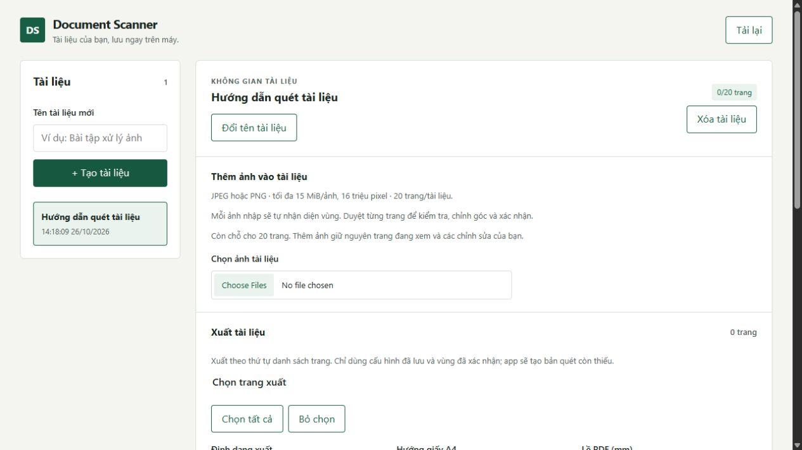
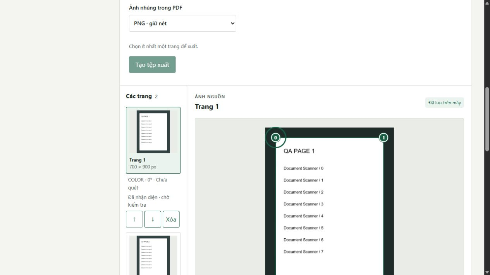
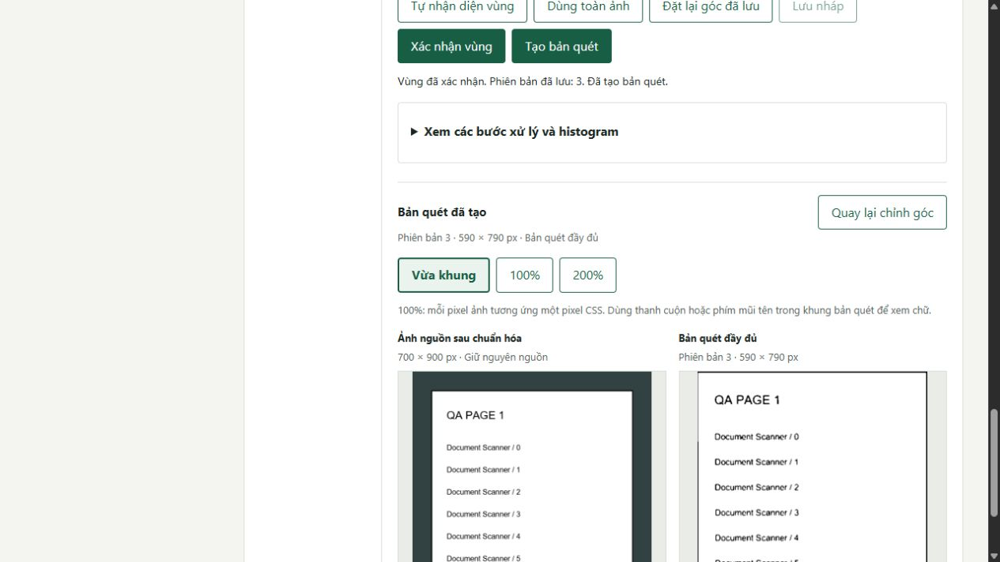
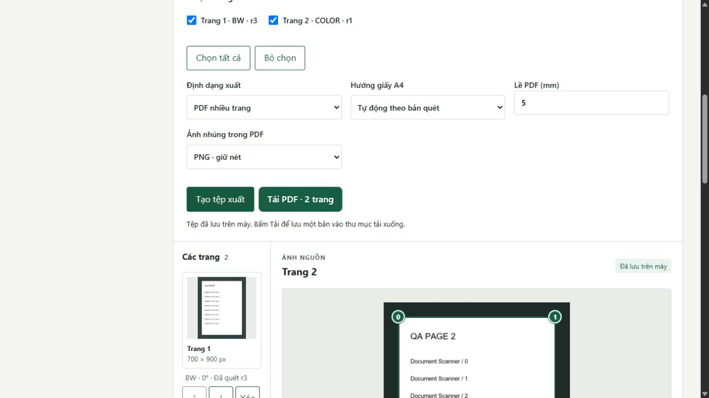

# Hướng dẫn sử dụng Document Scanner

Mở [ứng dụng cục bộ](http://127.0.0.1:8000/) sau khi làm theo [README cài/chạy](../README.md).
Hướng dẫn này đã được tự chạy từ một tài liệu mới trên bản build thật ở cổng8002,
dùng dữ liệu riêng để không ảnh hưởng tài liệu đang làm của người dùng.
Các ảnh chụp bên dưới là giao diện thật với ảnh tổng hợp có chữ QA PAGE, không phải bộ ảnh thực nghiệm13.

Để tự thử, lưu hai ảnh [mẫu trang1](images/user-guide/sample-source-01.png) và
[mẫu trang2](images/user-guide/sample-source-02.png) vào máy. Hai ảnh này nằm trong source,
không cần tải dataset cá nhân hoặc có sẵn thư mục experiments/results.

## 1. Tạo tài liệu và nhập ảnh

Nhập tên ở **Tên tài liệu mới**, bấm **+ Tạo tài liệu**. Tên xuất hiện trong danh sách bên trái.
Bấm **Chọn ảnh tài liệu**, chọn một hoặc nhiều JPEG/PNG. Đợi hết lượt nhập;
app lưu và tự nhận diện vùng lần lượt cho các ảnh nhập thành công. Không cần bấm nhận diện lại từng trang.

Kiểm tra **Kết quả nhập ảnh** và danh sách trang. Một tệp lỗi không làm mất các tệp đã nhập thành công;
có thể chọn lại riêng tệp cần sửa. Giới hạn là15MiB/ảnh,16triệu pixel và20trang/tài liệu.
Nhập thêm ảnh giữ trang đang xem và chỉnh sửa hiện tại; thao tác chỉ hoàn tất khi trạng thái nhập/nhận diện đã kết thúc.

Ảnh nguồn hiển thị là PNG sau chuẩn hóa EXIF và nền trắng cho ảnh trong suốt.
EXIF áp hướng được ghi trong tệp, không đọc chiều chữ hoặc tự quyết định giấy phải dọc.
Muốn đổi hướng bản quét, dùng **Xoay bản quét** ở bước3.

## 2. Duyệt vùng giấy, chỉnh và xác nhận

Bấm một trang trong danh sách. Kiểm tra khung bốn góc0–3 có đi theo mép tờ giấy không.
Đề xuất tự động luôn **chưa xác nhận**, kể cả khi điểm cao hoặc dòng **Hình học vùng hợp lệ** xuất hiện.
Điểm heuristic không phải xác suất nhận diện đúng; khung nền bàn vẫn có thể được chọn nhầm.

Kéo từng góc theo mép giấy. Có thể Tab tới nút góc, dùng mũi tên để dịch chậm,
Shift+mũi tên để dịch nhanh; Escape hủy lần kéo đang thực hiện. Giữ các góc theo chu kỳ,
không kéo cho cạnh cắt nhau. Sửa góc sẽ bỏ xác nhận trước đó.

Nếu chưa nhận diện được, kéo khung thử mặc định tới giấy. **Dùng toàn ảnh** chỉ chọn toàn bộ ảnh,
không có nghĩa phần mềm đã tìm đúng giấy. **Tự nhận diện vùng** chạy lại detector;
**Đặt lại góc đã lưu** khôi phục bản nháp từ cấu hình đã lưu, gồm cả lựa chọn xử lý.

Khi cần tạm dừng chỉnh, bấm **Lưu nháp**: góc/tham số được lưu nhưng vùng vẫn chưa xác nhận,
chưa đủ để tạo bản quét hoặc xuất. Khi đã kiểm tra đúng vùng, bấm **Xác nhận vùng**.
Chờ dòng **Vùng đã xác nhận** và thông báo đã lưu; không chỉ nhìn nút vừa bấm.

## 3. Chọn chế độ và tạo bản quét

Trong **Xử lý bản quét**, chọn chế độ phù hợp:

| Lựa chọn | Khi dùng và điều cần kiểm tra |
|---|---|
| Màu (Color) | Giữ màu, phù hợp tài liệu có tô màu/highlight. CLAHE và ngưỡng không hoạt động ở chế độ này. |
| Thang xám (Gray) | Ảnh xám; có thể bật CLAHE nếu muốn tăng tương phản cục bộ. |
| Đen trắng (BW) | Ảnh0/255. Chọn Otsu hoặc Adaptive, kiểm tra chữ nhỏ sau khi xử lý. |
| Không lọc / Median / Gaussian | Giữ nét gốc / giảm nhiễu nhưng có thể mất nét mảnh / làm mềm nhiễu và nét. |
| Otsu | Một ngưỡng cho toàn ảnh; vùng bóng có thể bị đen. Block/C không hoạt động. |
| Adaptive Gaussian | Ngưỡng cục bộ; có thể hữu ích khi sáng không đều nhưng giữ ô ly/nhiễu hoặc đứt nét. |
| Xoay bản quét |0/90/180/270° theo chiều kim đồng hồ; chỉ xoay kết quả, giữ nguồn. |

Ví dụ đã chạy: chọn **BW → Median → kernel3×3 → Otsu**, rồi **Tạo bản quét**.
Đổi chế độ giữ các lựa chọn trước đó, không tự tải một preset mới. Trường màu xám là không hoạt động,
vẫn được giữ khi chuyển chế độ. Với Adaptive, block phải lẻ3–151 và vừa cạnh ngắn vùng giấy sau warp;
nếu bị từ chối, giảm block hoặc chọn Otsu, app không tự thay tham số cho bạn.

Đổi bộ lọc chỉ sửa bản nháp. Nếu góc đã xác nhận và không đổi, bấm **Tạo bản quét** để lưu tham số
và xử lý lại. Nếu đổi góc, cần **Xác nhận vùng** trước. Mỗi lượt xử lý lấy lại ảnh nguồn đầy đủ,
không lọc chồng nhiều lần lên kết quả cũ.

Kiểm tra dòng **Đã tạo bản quét**, kích thước và phiên bản. Dùng **Vừa khung**, **100%**, **200%**
để xem chữ; tại100%/200% cuộn trong khung ảnh để xem các phần nằm ngoài màn hình.
**Quay lại chỉnh góc** đưa về vùng nguồn. Có thể mở **Xem các bước xử lý và histogram** để xem
ảnh trung gian của lượt chạy đã lưu; histogram trước ngưỡng chỉ có ở BW.
Otsu ghi một ngưỡng toàn ảnh, Adaptive không có một ngưỡng chung cho mọi pixel.

## 4. Phân biệt nháp, xác nhận và đang bận

| Trạng thái | Ý nghĩa và thao tác tiếp theo |
|---|---|
| Bản nháp khác cấu hình đã lưu (dirty) | Bạn vừa đổi góc/tham số. Đổi trang hoặc reload có thể bỏ thay đổi này. Lưu nháp, xác nhận hoặc tạo bản quét theo các bước trên trước khi rời trang. |
| Nháp đã lưu, vùng chưa xác nhận | Dữ liệu nháp tồn tại trên máy nhưng chưa được chấp nhận để xuất. **Lưu nháp** luôn lưu trạng thái chưa xác nhận; cần bấm **Xác nhận vùng** khi tiếp tục. |
| Vùng đã xác nhận (confirmed) | Người dùng đã chấp nhận bốn góc. Chưa có nghĩa bản quét đã được tạo, đúng ý hoặc các tham số vừa chỉnh đã lưu. |
| Đang đọc/lưu/nhận diện/tạo bản quét/xuất (busy) | App đang làm việc; một số nút tạm khóa. Chờ thông báo kết thúc, tránh bấm lặp hoặc đóng server. Trong lúc nhận diện vẫn có thể chỉnh góc tay; đề xuất về muộn không ghi đè góc đã chỉnh. |
| Kết quả cũ | Bản quét thuộc cấu hình/phiên bản trước. Kiểm tra và tạo bản quét mới; không coi ảnh cũ đang thấy là kết quả của tham số vừa đổi. |
| Cần đọc lại cấu hình | Lưu/xử lý lỗi hoặc dữ liệu bị đổi ở nơi khác. Ghi nhớ phần chưa lưu, dùng **Tải lại** để đối soát, kiểm lại vùng và chủ động thử tiếp. |

Mỗi trang có trạng thái riêng. Xác nhận trang đang mở không tự xác nhận tất cả trang được chọn xuất.

## 5. Xuất PDF hoặc ảnh

Trong panel **Xuất tài liệu**, chọn checkbox của các trang cần xuất hoặc **Chọn tất cả**.
Thứ tự xuất theo danh sách trang hiện hành, không theo thứ tự bấm checkbox.
Nếu cần đổi thứ tự, dùng nút↑/↓ bên trang trước khi xuất.

- **PDF nhiều trang:** chọn hướng A4 tự động/dọc/ngang, lề0–30mm và kiểu ảnh nhúng PNG/JPEG.
  Tự động chọn hướng theo bản quét; PNG giữ nét, JPEG nén mất dữ liệu.
- **Ảnh PNG / Ảnh JPG:** chỉ chọn đúng một trang. PNG giữ nét tốt; JPG có nén mất dữ liệu.

Bấm **Tạo tệp xuất**. App kiểm tra vùng và cấu hình của từng trang; nháp chưa lưu hoặc trang chưa xác nhận
phải được xử lý trước. Trang đã xác nhận còn thiếu bản quét sẽ được tạo tự động,
nhưng app không tự xác nhận vùng thay bạn. Khi xuất, chờ hoàn tất rồi mới chỉnh hoặc đổi tài liệu.

Khi thấy **Tải PDF · 2 trang** hoặc liên kết tải đúng định dạng/số trang, bấm **Tải**.
Tệp tạo thành công đã lưu trong app; thao tác tải lưu thêm bản vào thư mục tải xuống của trình duyệt
(thường là Downloads). Tên tệp có thể là UUID. Mở tệp vừa tải để kiểm tra trang, thứ tự, hướng và chữ.
PDF hiện gồm ảnh, chưa tìm kiếm/copy chữ như tài liệu OCR.

Nếu báo chưa xác nhận: lần lượt mở **tất cả các trang đang được chọn xuất**, kiểm vùng và xác nhận,
rồi xuất lại. Nếu còn nháp, lưu/kiểm lại hoặc bỏ thay đổi chưa lưu một cách chủ động.
Chờ và đọc thông báo khi server bận/mất kết nối; không bấm tạo liên tiếp khi chưa rõ lượt trước đã hoàn tất.

## 6. Lưu và mở lại ngày hôm sau

Nhập ảnh, lưu nháp, xác nhận và tạo bản quét đều lưu ngay khi thao tác thành công;
không có thêm một nút “lưu toàn tài liệu” cuối quy trình. Để an toàn, kiểm tra thông báo kết thúc
trước khi đóng tab hoặc dừng server bằng Ctrl+C như [README](../README.md).

Giữ nguyên toàn bộ thư mục **data/**. Khởi động lại cùng source/data, mở ứng dụng,
chọn tài liệu trong danh sách rồi chọn trang: nguồn, cấu hình đã lưu và bản quét gần nhất được đọc lại,
không cần nhập ảnh hoặc chạy nhận diện từ đầu. Kết quả không khớp cấu hình hiện tại vẫn được đánh dấu cũ.

Nháp chưa lưu có thể mất. Checkbox xuất, kết quả nhập theo batch và link tải vừa tạo không phải
lịch sử giao diện được khôi phục đầy đủ khi reload. Có thể chọn lại trang và tạo một lượt xuất mới.
Muốn sao lưu hoặc chuyển máy/thư mục, dừng server rồi sao chép cả **data/** cùng source;
không chỉ lấy riêng scanner.sqlite3 hoặc đổi tên các tệp ảnh UUID.

## Khi chất lượng chưa đạt

Chọn lại góc nếu ăn nền bàn/mất mép giấy; dùng Color/Gray hoặc đổi ngưỡng/bộ lọc nếu BW mất nét.
Nếu giấy cong/nhàu mạnh, ảnh lóa hoặc chữ bị che, nên trải giấy và chụp lại.
Homography không làm phẳng mọi nếp gấp, và bộ lọc không phục hồi được thông tin đã mất.
Các lỗi cài/chạy/quota/DB được liệt kê trong [README](../README.md#khi-không-mở-được-hoặc-không-xuất-được).
